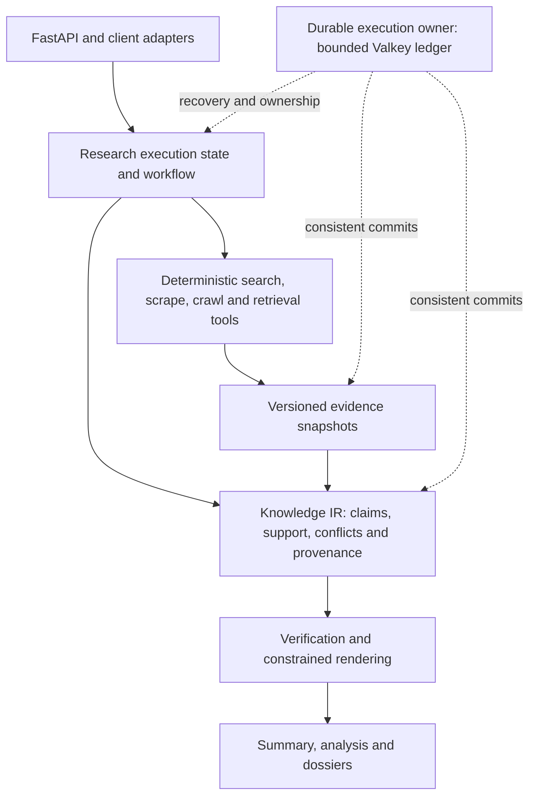

# GroktoCrawl X: experimental research architecture plan

- Status: bounded experimental runtime and contract work underway; replacement decision remains open
- Accountable owner and architecture decider: Magnus Hedemark (`magnus919`)
- Date: 2026-09-04
- Repository: [magnus919/groktocrawl-x](https://github.com/magnus919/groktocrawl-x)
- Mainline: [groktopus/groktocrawl](https://github.com/groktopus/groktocrawl)
- Starting revision: [`34b4975bc7baaf25510ed34029b957f95b59de70`](https://github.com/groktopus/groktocrawl/commit/34b4975bc7baaf25510ed34029b957f95b59de70)
- Input: [discussion #427 and its Knowledge IR follow-up](https://github.com/groktopus/groktocrawl/discussions/427)
- Tracking issue: [#1](https://github.com/magnus919/groktocrawl-x/issues/1)
- Proposed charter: [ADR-0067](../adr/experimental/groktocrawl-x/0067-establish-an-independent-research-architecture-experiment.md)
- Experiment index: [experiment documentation guide](README.md)

**This is an experimental fork, not a replacement for mainline GroktoCrawl.**
The owner authorized creating and planning the fork, explicitly including new ADRs
that can overturn inherited architecture. Technical decisions are governed by their
current ADR status and confirmation evidence. This plan does not authorize a
mainline rewrite, production migration, or upstream release.

The repository preserves upstream main's complete reachable Git history. It is a
separate GitHub repository, as requested after GitHub returned the owner's existing
fork. The existing `magnus919/groktocrawl` repository is unchanged.

## Intended outcome

A world-class deep-research substrate serves the user's research needs first and
can expand as models and search tools become more capable. Enterprise use is a
possible application, not a product assumption or the architecture's organizing
requirement. Candidate infrastructure must earn its complexity by enabling better
research experiences, safer extension, or capabilities that the simpler reference
cannot express clearly.

A research request produces an inspectable, reusable body of claims and evidence.
A specialized workflow plans, gathers, assesses, deepens, verifies, and renders
that knowledge under explicit budgets. Execution state, knowledge, and presentation
have distinct lifecycles. The output remains a three-layer Artifact Pyramid:
summary, analysis collection, and detailed dossiers. Whether LangGraph, another
explicit workflow library, or a typed imperative implementation best supports this
is a decision to test. Durable execution, potentially Temporal, is a first-class
architecture decision rather than automatically deferred by ADR-0047.

The experiment keeps deterministic retrieval/crawl behavior outside LLM judgment.
The data plane is a reusable capability boundary; the current deployment topology
is not mandatory. Existing Python/FastAPI tools and the OpenAI-compatible provider
boundary are useful starting assets, subject to explicit interface decisions.



This diagram is the proposed responsibility model, not a deployed service map.

## Baseline and scope

The fork starts after upstream ADRs 0059–0066. The research core already shares an
event engine, reuses artifacts across passes, performs gap-directed acquisition,
and emits one final synthesis. Progressive acquisition and optional independent
session steps also exist. Re-measure this baseline; do not sell those existing
features as benefits attributable to a new framework.

In scope: architecture replacement decisions; portable Knowledge IR; evidence
verification; reusable artifacts; explicit workflow state and budgets; resumability
requirements; client/event contracts; framework comparison; isolated rollout.

Outside this plan: mainline replacement; a generic multi-agent swarm; rebuilding
all adapters; managed hosting or billing; assuming an entire production tenancy
model; publishing fork builds under upstream image/package identities. Additional
requirements require a recorded scope decision, not an incidental implementation.

## Architecture decision work

Write these as separate MADR records in `docs/adr/` before the dependent production
implementation. Bounded evaluation spikes may precede runtime selection; they do
not silently accept their candidate ADR. D1–D7 are backlog IDs, not reserved ADR
numbers. Allocate the next available four-digit number when each PR is opened.

| ID | New ADR to write | Decisions and alternatives to resolve | Inherited decisions to assess | Acceptance evidence / due gate |
|---|---|---|---|---|
| D1 | Separate research execution, knowledge, and rendering | Ownership, module/service boundaries, specialized workflow, portable contracts; compare event-first orchestration with explicit graph state | 0017, 0023, 0040, 0042, 0050, 0063–0066 | State transitions, dependency diagram, single-writer/commit rules; before W2 |
| D2 | Define a versioned Knowledge IR and verification contract | Claim identity; snapshot and span references; support, contradiction and derivation edges; epistemic statuses; source quality/freshness; verifier provenance; human vs machine review labels | 0004, 0016, 0024, 0041, 0049, 0050, 0059, 0064 | Example valid/invalid records and render/audit invariants; before W2 |
| D3 | Store and retain evidence independently of sessions | Authoritative store; local/object/blob and metadata options; Valkey's role; derived vector index; pgvector consolidation versus Qdrant if PostgreSQL is adopted; retention, export, garbage collection, schema/model migrations | 0019, 0026–0030, 0040–0041, 0049–0050, 0059, 0063, 0066 | Expired-session, deleted-source, partial-write and restore scenarios; before W3 |
| D4 | Select the research orchestration runtime | LangGraph vs current/typed imperative loop vs a bounded alternative such as Pydantic Graph; reducers, retries, context propagation, cancellation, state migration, operational footprint | 0022, 0031, 0033, 0035, 0040, 0048, 0051, 0064–0066 | Same-policy conformance comparison and engineering assessment; after W4 spike, before adoption |
| D5 | Define durable execution ownership and recovery | Explicit recovery target; Temporal vs Valkey leases/outbox vs graph-only recovery; one owner of retries/cancellation; idempotency, leases, side effects, artifact commit, webhook outbox | 0012, 0035, 0038, 0045, 0047, 0051, 0063, 0066 | Crash matrix and recovery/cancellation proof; before W5 implementation; expressly revisit 0047 |
| D6 | Expose verified artifacts through compatible client protocols | FastAPI edge; stable source/claim IDs; SSE lifecycle; provisional vs verified text; checkpoint/event replay; compact sessions; JSON/schema output; API/CLI/MCP parity | 0017, 0022, 0024, 0032, 0039–0042, 0053, 0064–0066 | Wire examples and golden client traces; before W6 |
| D7 | Evaluate and adopt or reject the new architecture | Fixed comparison design; realistic quality evaluation; uncertainty and cost/latency limits; evidence retention; continuation and abandonment criteria | 0018, 0048, 0054–0057 plus existing answer evals | Pinned manifest, rubric, hard gates, cost ceiling and decision report template; before comparisons |

Every new ADR must include status, decider, date, context, drivers, options with
tradeoffs, outcome, consequences, links, and a confirmation plan. Its impact table
must classify each affected predecessor as retained, extended, partially superseded,
or superseded. References in the table above identify review candidates, not a
blanket declaration that all those records are obsolete.

At acceptance, update only predecessor status/successor references and the index,
with the exact scope of partial supersession. Keep accepted decision bodies and
historical links intact. Update affected AGENTS.md guidance, architecture diagrams,
operator docs and tests in the implementation PR. Do not change upstream ADR status.
In particular, the mainline preference for Valkey-native durability and deferral of
Temporal is an input to D5, not a constraint on its outcome.

## Architecture foundation and historical progress record

This section preserves the chronological evidence trail. Statements such as
"remaining" or "proposed" describe the checkpoint immediately around them; use
the [GitHub execution tracker](#github-execution-tracker) for current status.

Following merged PR #2, [issue #3](https://github.com/magnus919/groktocrawl-x/issues/3)
tracks the first W1 decision package:

- D1: [ADR-0068 — execution, knowledge and rendering boundaries](../adr/experimental/groktocrawl-x/0068-separate-research-execution-knowledge-and-rendering.md), accepted 2026-09-05.
- D2: [ADR-0069 — versioned Knowledge IR and verification](../adr/experimental/groktocrawl-x/0069-define-versioned-knowledge-and-verification.md), accepted 2026-09-05.
- D7: [ADR-0070 — separate runtime and policy evaluation](../adr/experimental/groktocrawl-x/0070-evaluate-research-policy-and-runtime-separately.md), accepted 2026-09-05.
- [Worked conflicting-source example](research-foundation-example.md), with immutable
  snapshot hashes, evidence locators, expected claims/verification, three renderings
  and failure variants. It is synthetic design evidence, not a runtime test result.

D3 has an accepted bounded-exploration decision in [ADR-0071](../adr/experimental/groktocrawl-x/0071-store-research-evidence-independently-of-sessions.md),
tracked by [issue #5](https://github.com/magnus919/groktocrawl-x/issues/5), with a
[lifecycle and failure matrix](research-storage-lifecycle.md). It recommends a
single authoritative PostgreSQL store for bounded evidence and metadata, subject
to review and real-database validation. It also requires evaluating PostgreSQL +
pgvector as a replacement for Qdrant, with retrieval parity, concurrent-load,
footprint and reversible-cutover gates before retaining two permanent databases.
The concrete comparison plan was tracked in [issue #163](https://github.com/magnus919/groktocrawl-x/issues/163),
which is now closed for the completed bounded fixture, repeat-round, concurrency,
restart and fresh-target restore packets. The remaining failure-injection,
migration, footprint and reversible-cutover gates are tracked in [issue #201](https://github.com/magnus919/groktocrawl-x/issues/201)
and [the pgvector/Qdrant evaluation plan](storage/pgvector-qdrant-evaluation.md).
The first successful bounded fixture packet is recorded in the [storage evaluation evidence](evidence/storage-vector-evaluation/2026-09-08/); the first three-round packet is in [the repeated-round evidence](evidence/storage-vector-evaluation/2026-09-08-rounds-3/). The fresh-resource packet is in [the fresh-round evidence](evidence/storage-vector-evaluation/2026-09-08-fresh-3/). The first mixed-concurrency packet is in [the concurrency evidence](evidence/storage-vector-evaluation/2026-09-08-concurrency-4x40/). The provider-restart packet is in [the restart evidence](evidence/storage-vector-evaluation/2026-09-08-restart/). The fresh-target backup/restore packet is in [the backup/restore evidence](evidence/storage-vector-evaluation/2026-09-08-backup-restore/). These packets are repeatability and recovery evidence, not a storage selection; the remaining decision gates are tracked in #201.
The deterministic [failure-injection contract packet](evidence/storage-vector-evaluation/2026-09-08-failure-injection/)
now records provider-independent fail-closed and rollback expectations. It does
not replace provider replay, scale/footprint, migration/rollback or reversible-
cutover evidence. The first isolated Qdrant and pgvector replay passed all six
failure scenarios in the [2026-09-08 provider packet](evidence/storage-vector-evaluation/2026-09-08-provider-fault/);
the first bounded scale run passed the corrected correctness gates in the
[2026-09-08 scale packet](evidence/storage-vector-evaluation/2026-09-08-scale-r3/).
The scale result remains a pass with gaps because the write paths are not yet
equivalently batched and the resource capture is not a sustained time series.
Representative scale, migration/rollback and reversible-cutover gates remain open.
The follow-up [transaction-batched scale packet](evidence/storage-vector-evaluation/2026-09-08-scale-batched-r1/)
also passed correctness and reduced pgvector write overhead, but `executemany`
still uses repeated SQL statements and the single-run tails varied. Native bulk
writes and repeated rounds remain open before a storage decision.
The [three-round native-bulk packet](evidence/storage-vector-evaluation/2026-09-08-scale-native-repeated-r1/)
then passed every correctness gate with zero failures and consistent directional
results: Qdrant bulk writes were faster, while pgvector filtered reads were
faster. It closes native-bulk and repeated-round comparability only for the tiny
synthetic fixture; representative scale, sustained resource evidence,
migration/rollback and reversible cutover remain open.
The [larger 1,024-dimensional packet](evidence/storage-vector-evaluation/2026-09-09-scale-1024d-larger-r1/)
then passed three rounds through 10,000 records with equal ingestion batches and
zero failures. It records different tradeoffs rather than a winner: Qdrant led
median ingestion and the 10,000-record median/mixed workload, while pgvector had
a tighter search tail. The follow-up [sustained workload packet](evidence/storage-vector-evaluation/2026-09-09-scale-1024d-sustained-r2/)
completed 15,000 mixed operations per provider without a failure and captured
phase-attributed CPU and memory samples. It remains a short isolated component
run rather than production capacity evidence. Migration/rollback and reversible
cutover remain open.
The [dimension migration packet](evidence/storage-vector-evaluation/2026-09-09-migration-r1/)
then passed target-schema, retrieval reconciliation, cutover, deletion continuity,
and rollback gates for both isolated providers. The remaining storage work is an
application-level pilot shape, operational-surface comparison, and reviewed
adoption or retention ADR.
The [operational-surface comparison](storage/vector-operational-surface.md)
recommends an experimental shadow-pgvector pilot while Qdrant remains
authoritative. The fail-open adapter and application wiring are merged through
[PR #226](https://github.com/magnus919/groktocrawl-x/pull/226), and the
[pilot protocol](storage/pgvector-shadow-pilot.md) plus
[issue #227](https://github.com/magnus919/groktocrawl-x/issues/227) track the
application pilot. The first
[application shadow packet](evidence/storage-vector-evaluation/2026-09-09-application-shadow-pilot/)
passed response-equivalence, fail-open, exact reconciliation, and bounded
shared-database correctness checks. Two normal comparisons exposed asynchronous
write lag, so Qdrant remains authoritative while sustained mixed traffic and the
reviewed provider decision remain open in #201. The follow-up
[sustained shadow-lag packet](evidence/storage-vector-evaluation/2026-09-09-shadow-lag-sustained/)
recorded 360 matching comparisons, bounded all 240 shadow write completions within
75 ms, passed concurrent retained-artifact checks, and restored exact parity after
an outage. It supports the reversible experimental cutover accepted in
[ADR-0079](../adr/experimental/groktocrawl-x/0079-consolidate-retained-and-vector-storage-in-postgresql.md);
The subsequent
[application serving packet](evidence/storage-vector-evaluation/2026-09-09-pgvector-serving-cutover/)
passed pinned response parity, synchronous mutation, provider-outage, concurrent
shared-database, and rollback checks. Qdrant remains the rollback target until
the explicit experimental rollback window completes.
D6 has an accepted client contract in [ADR-0072](../adr/experimental/groktocrawl-x/0072-expose-verified-research-through-an-experimental-protocol.md),
tracked by [issue #9](https://github.com/magnus919/groktocrawl-x/issues/9), with
[wire examples and confirmation scenarios](research-client-protocol.md). It recommends
an explicit experimental route family, progress-only streaming before audited
publication, one pinned terminal result, bounded replay and compact session references.
D4 has an accepted bounded comparison contract in [ADR-0073](../adr/experimental/groktocrawl-x/0073-compare-research-runtimes-under-one-policy.md).
D5 has an accepted recovery contract in [ADR-0074](../adr/experimental/groktocrawl-x/0074-define-research-recovery-before-selecting-infrastructure.md),
with a shared [conformance/crash matrix](research-execution-confirmation.md), tracked
by [issue #11](https://github.com/magnus919/groktocrawl-x/issues/11). These frame the
accepted runtime choice: ADR-0073 retains the imperative reference; it
remains authoritative and LangGraph is available for advanced workflows. The
bounded accepted scopes are recorded in the [ADR index](../adr/README.md).
The [W1 acceptance review](research-acceptance-review.md) and
[draft preflight manifest](research-preflight.json) pin existing regression evidence
and identify the decisions and baseline inputs still required.
Inherited ADR metadata records only the accepted experimental successor scopes;
inherited endpoint implementations remain unchanged. The W1 baseline and candidate
comparison are complete. W2 produced a bounded executable fixture and exposed
semantic-generalization limits that later evaluations carry forward. The current
state of every active workstream is maintained in the tracker below.

## Work breakdown and sequencing

Magnus is accountable for all workstreams and decision gates. Each implementation
issue must name its contributor/agent and reviewer before work begins. Ownership
below is by role; it is not a claim that additional people have committed capacity.
Estimates are rough active contributor-days, excluding provider spend, CI provisioning
and review queues. Re-estimate after W1; these are not delivery dates.

| ID | Vertical slice / owner role | Hard dependencies | Deliverable and completion criterion | Estimate |
|---|---|---|---|---|
| W0 | Establish fork identity and engineering lanes / maintainer | None | Clear README/metadata, recorded upstream SHA, fork issue/PR targets; validate hosted checks, fork runtime runner and required rulesets; isolate release identities before enabling publication | 1–2 days |
| W1 | Architecture decision pack and baseline / architecture + evaluation owner | D1–D7 decision packet, frozen baseline, and accepted comparison evidence complete | **Complete.** The original packet, isolation review, incumbent run, and [primary semantic review](enterprise-evaluation/w1-incumbent-semantic-review-2026-09-09.md) are complete. Candidate B policy 3 froze at `36f999514cf0dc8eb3164c4cac50a7ba0002618f`. A fresh [replacement packet](enterprise-evaluation/w1-replacement-packet-2026-09-10.md) was independently curated after the freeze and approved for isolation. The authorized [paired comparison](enterprise-evaluation/w1-comparison-outcome-2026-09-10.md) completed all 300 attempts. Candidate B completed 39/150 versus 77/150 for Arm A, exceeded both latency limits by more than two times, and used 15.7 times the reported tokens. The [semantic learning review](enterprise-evaluation/w1-semantic-learning-review-2026-09-10.md) found worse strict support, citation correctness, and full-study coverage, while completed B answers showed slightly better subquestion coverage. Magnus accepted the zero-upheld-critical-flag disposition on 2026-09-10. Candidate B is rejected as the current replacement; a leaner evidence-first successor is separate follow-on work. | Complete |
| W2 | One evidence-grounded answer end to end / research owner | D1, D2; W1 fixture contract | Existing tools acquire pinned sources, construct claims/evidence, verify, render an answer, audit every material factual assertion; all bounded fixtures pass | 4–7 days |
| W3 | Reopen and re-render a research artifact / storage owner | W2, D3 | Retained snapshots and IR survive session expiry; export/import and version checks work; re-render without retrieval; missing/stale evidence is explicit | 3–5 days |
| W4 | Equivalent workflow backends / research + evaluation owner | W2, D7; W3 for persistence cases | **Complete:** 720 bounded-workflow records and 600 future-scenario records conform. Retain the imperative reference and recommend LangGraph as an optional advanced runtime. Dynamic fan-out, durable interrupts, checkpoint forks, and pinned capability evolution justify a pilot; application authority remains outside the graph | 3–5 days plus future-capability experiment |
| W5 | Interrupt and recover a research job / execution owner | D3, D4, D5, W3, W4 | Selected execution owner resumes at declared boundaries, controls retries/cancellation, and commits consistent artifacts/webhook intent under injected failures | 5–8 days |
| W6 | Complete a client/session journey / API + CLI owner | D6, W3, W4; W5 for recovery guarantees | HTTP, SSE, polling, CLI and applicable MCP paths expose one coherent artifact, compact references and all three pyramid layers, including terminal/error/reconnect semantics | 4–6 days |
| W7 | Evaluate, pilot and decide / maintainer + evaluation owner | W5, W6, D7 | **Complete.** The [held-out comparison](enterprise-evaluation/w7-candidate-d-outcome-2026-09-11.md) rejected Candidate D: it completed 4 of 150 attempts versus 134 for the incumbent and exceeded the median-latency limit. The four completed outputs could not establish a quality improvement. ADR-0080 is rejected for this candidate; its useful evidence and publication constraints remain input to future design. | Complete 2026-09-11 |
| W8 | Adaptively acquire sufficient evidence / retrieval + research owner | W7 decision | **Complete.** The [retrieval comparison](enterprise-evaluation/w8-retrieval-comparison-2026-09-11.md) retained current SlopSearX. The [bounded planning comparison](enterprise-evaluation/w8-adaptive-planning-outcome-2026-09-11.md) retained query formulation as a recovery tool but rejected indiscriminate model stopping. The [diversity comparison](enterprise-evaluation/w8-source-diversity-outcome-2026-09-11.md) selects bounded quality and publisher independence, while deliberate opposition remains conditional. The [freshness and identity comparison](enterprise-evaluation/w8-freshness-identity-outcome-2026-09-11.md) requires exact retrieval, separate nullable times, canonical/content deduplication with retained provenance, and explicit link-rot evidence. The [blinded source-equivalence audit](enterprise-evaluation/w8-source-equivalence-outcome-2026-09-11.md) found useful evidence in every attempted case but higher precision for the fixed-query baseline, confirming adaptive formulation belongs behind explicit evidence gaps. SlopSearX changes must be additive, optional, generally useful and backward compatible. | Complete 2026-09-11 |
| W9 | Rehearse the replacement candidate / maintainer + operations owner | W8; accepted deployment manifest | **Complete and owner-ratified.** Candidate freeze, matched compatibility, migration and rollback, PostgreSQL authority, pgvector serving, independent agent-use repairs, and the bounded similarity decision have passed. The frozen pilot used LiteLLM `free` at runtime revision `46a528228b1365189cdd38d0bcdb12109a8dc763`; subsequent operational repairs are tracked in the post-roadmap section below. [Checkpoint 0](evidence/replacement-rehearsal/2026-09-23-free-model-checkpoint-0/README.md) and [checkpoint 1](evidence/replacement-rehearsal/2026-09-26-free-model-checkpoint-1/README.md) each passed all 12 operations; final [checkpoint 2](evidence/replacement-rehearsal/2026-09-30-free-model-checkpoint-2/README.md) passed on the single permitted retry, giving 36 successful operations and 3/3 checkpoints. pgvector serves and Qdrant remains rollback ready. The [final recommendation](w9-replacement-readiness-decision.md) records the transient model-health failure, passing verification, limits and owner ratification. | Complete 2026-09-30 |
| W10 | Harden adaptive research policy / research owner | W9 candidate freeze; W8 source-equivalence evidence | **Complete.** The [W10 evidence package](evidence/adaptive-policy/w10-final/00-index.md) accounts for all 540 trials and 4,487 blinded adjudications. The full bounded policy lost 33.3 percentage points of weighted closure on the W8 anchor, only 11.1% of follow-ups produced an evidence gain, and no challenge type passed. [ADR-0081](../adr/experimental/groktocrawl-x/0081-select-a-bounded-adaptive-research-policy.md) keeps fixed retrieval as the default while preserving the state contracts for future policy experiments. | Complete 2026-09-12 |
| W11 | Evaluate SlopSearX research workflows / retrieval + research owner | W10 evidence and SlopSearX 0.5 capability freeze | **Complete: narrow adoption.** The [W11 findings](slopsearx-substrate/w11-findings.md) retain ordinary SearXNG-compatible flat search and reject broad caller-directed continuation after all recorded workflows exhausted their result budgets. Richer receipts, manifests, saved searches, and dossiers remain opt-in capability slices under accepted ADR-0082. | Complete 2026-09-12 |
| W12 | Test research agent contracts and value / research + evaluation owner | W11 narrow integration; D1–D7 | **Complete and owner-ratified.** Five bounded studies rejected universal typed missions, default longitudinal thread injection, and generic specialist fan-out while supporting experimental semantic claim verification and opt-in evidence-obligation continuation. The [W12 evidence ledger](#github-execution-tracker) and accepted ADRs 0083–0087 retain each decision boundary. | Complete; bounded ADRs accepted 2026-09-30 |
| W13 | Normalize autonomous barrier recovery / scraping owner | ADR-0015, ADR-0044 | **Complete.** [PR #364](https://github.com/magnus919/groktocrawl-x/pull/364) and accepted ADR-0088 centralize a bounded recovery ladder in scraper-svc; direct scrape, agent, crawl, CLI, and MCP inherit classified terminal behavior. The current W9 candidate includes this runtime. | Complete 2026-09-21 |

Expected planning range for a single contributor: **33–56 active days**, before
uncertainty and review/provisioning delays. Capacity is uncommitted. The dependency
path is W0 → W1 → W2 → (W3 and W4) → W5 → W6 recovery acceptance → W7 → W8 → W10 → W11. W3 and W4
can overlap after W2. W6 client contract tests can begin after D6, and interface
work can overlap W5; recovery claims cannot. Storage contracts, CI access, and
runtime selection can each move the completion date. Do not schedule downstream
implementation around an unreviewed ADR.

### GitHub execution tracker

The following issues and milestones are the execution index for this plan. Keep
issue acceptance checklists, ADR status, and this document synchronized whenever a
slice changes state. An issue is only closed by a PR whose validation demonstrates
its acceptance criteria; passing structural checks alone does not close an evidence
gate.

| Workstream | Milestone | Execution issue | Current state |
|---|---|---|---|
| W0–W2 | [Foundation history](https://github.com/magnus919/groktocrawl-x/milestone/6) | [#1](https://github.com/magnus919/groktocrawl-x/issues/1), [#116](https://github.com/magnus919/groktocrawl-x/issues/116) | Fork setup and W1 are complete. The replacement packet was independently curated and approved; the 300-attempt paired comparison rejected Candidate B on completion, latency, token use, and semantic quality. W2 delivered the bounded evidence-to-artifact fixture, with its semantic and generalization limits explicitly retained for later work. |
| W3 | [Retention and reuse](https://github.com/magnus919/groktocrawl-x/milestone/1) | [#108 export](https://github.com/magnus919/groktocrawl-x/issues/108), [#109 import](https://github.com/magnus919/groktocrawl-x/issues/109), [#122 restore](https://github.com/magnus919/groktocrawl-x/issues/122), [#201 vector gates](https://github.com/magnus919/groktocrawl-x/issues/201), [#230 shadow lag](https://github.com/magnus919/groktocrawl-x/issues/230) | Bounded export/import, restore/deletion continuity, provider comparisons, fault/scale/migration evidence, application shadowing, pgvector serving cutover, and rollback rehearsal are complete. ADR-0079 is accepted for the experimental deployment. W9 passed; Qdrant remains available until separately reviewed retirement work. |
| W4 | [Runtime comparison](https://github.com/magnus919/groktocrawl-x/milestone/2) | [#110](https://github.com/magnus919/groktocrawl-x/issues/110), [#245](https://github.com/magnus919/groktocrawl-x/issues/245) | Complete with 1,320 conforming records: 720 bounded workflow; [420 replanning/specialist](evidence/future-runtime/2026-09-09/); [60 guidance](evidence/future-runtime/2026-09-10-guidance/); [60 forks](evidence/future-runtime/2026-09-10-forks/); and [60 capability evolution](evidence/future-runtime/2026-09-10-capabilities/). Owner-accepted ADR-0073 retains the imperative reference plus optional advanced LangGraph workflows. Broader LangGraph promotion remains subject to real-user and checkpoint operating gates. |
| W5 | [Durable execution and recovery](https://github.com/magnus919/groktocrawl-x/milestone/3) | [#111](https://github.com/magnus919/groktocrawl-x/issues/111) | Contract fixture merged by [PR #118](https://github.com/magnus919/groktocrawl-x/pull/118); the bounded Valkey ownership ledger and hosted recovery lane merged in [PR #135](https://github.com/magnus919/groktocrawl-x/pull/135); checkpoint and terminal-projection persistence merged in [PR #137](https://github.com/magnus919/groktocrawl-x/pull/137); durable status recovery and persisted cancellation are merged in [PR #139](https://github.com/magnus919/groktocrawl-x/pull/139); bounded artifact-byte and terminal-event recovery is merged in [PR #142](https://github.com/magnus919/groktocrawl-x/pull/142); provider ambiguity and terminal-race evidence is merged in [PR #144](https://github.com/magnus919/groktocrawl-x/pull/144); the complete crash/cancel matrix is merged in [PR #146](https://github.com/magnus919/groktocrawl-x/pull/146); validated backup/restore, reclaim-after-restore behavior and durable deletion tombstones are merged in [PR #148](https://github.com/magnus919/groktocrawl-x/pull/148), with hosted evidence recorded in [the W5 packet](durable-backup-restore.md) and accepted [ADR-0078](../adr/experimental/groktocrawl-x/0078-define-durable-research-backup-and-artifact-authority.md). [PR #243](https://github.com/magnus919/groktocrawl-x/pull/243) established the atomic PostgreSQL artifact-set store; [PR #244](https://github.com/magnus919/groktocrawl-x/pull/244) wired it through the durable route with compact Valkey pointers, deterministic reconciliation, and PostgreSQL-first deletion; [PR #247](https://github.com/magnus919/groktocrawl-x/pull/247) passed the combined PostgreSQL/Valkey restore rehearsal. Accepted [ADR-0074](../adr/experimental/groktocrawl-x/0074-define-research-recovery-before-selecting-infrastructure.md) selects the bounded Valkey ledger as execution owner while keeping orchestration replaceable. W5 is complete; W6 must now prove the recovered client journey across HTTP, SSE, CLI, and MCP. |
| W6 | [Verified client protocols](https://github.com/magnus919/groktocrawl-x/milestone/4) | [#112](https://github.com/magnus919/groktocrawl-x/issues/112) | Contract, golden traces and opt-in capabilities merged by [PR #119](https://github.com/magnus919/groktocrawl-x/pull/119), [PR #120](https://github.com/magnus919/groktocrawl-x/pull/120) and [PR #121](https://github.com/magnus919/groktocrawl-x/pull/121); CLI/MCP capability-discovery parity is implemented in [PR #128](https://github.com/magnus919/groktocrawl-x/pull/128), the bounded fixture run/artifact/evidence adapter merged in [PR #129](https://github.com/magnus919/groktocrawl-x/pull/129), and the matching CLI/MCP journey merged in [PR #130](https://github.com/magnus919/groktocrawl-x/pull/130); attachment-only session support merged in [PR #131](https://github.com/magnus919/groktocrawl-x/pull/131); bounded foreign-scope and deletion-tombstone race evidence merged in [PR #133](https://github.com/magnus919/groktocrawl-x/pull/133). [PR #251](https://github.com/magnus919/groktocrawl-x/pull/251) passed the recovered HTTP/SSE/CLI/MCP artifact journey with scope and deletion continuity. W6 is complete for the bounded experimental route. |
| W7 | [Evaluation and adoption decision](https://github.com/magnus919/groktocrawl-x/milestone/5) | [#103](https://github.com/magnus919/groktocrawl-x/issues/103), [#113](https://github.com/magnus919/groktocrawl-x/issues/113), [#280](https://github.com/magnus919/groktocrawl-x/issues/280) | Complete; Candidate D rejected, umbrella #103 continues through W8 and replacement rehearsal |
| W8 | [Adaptive evidence acquisition](https://github.com/magnus919/groktocrawl-x/milestone/7) | [#294 retrieval](https://github.com/magnus919/groktocrawl-x/issues/294), [#295 planning](https://github.com/magnus919/groktocrawl-x/issues/295), [#296 diversity](https://github.com/magnus919/groktocrawl-x/issues/296), [#297 freshness](https://github.com/magnus919/groktocrawl-x/issues/297), [#307 source equivalence](https://github.com/magnus919/groktocrawl-x/issues/307), [SlopSearX #307](https://github.com/magnus919/SlopSearX/issues/307), [SlopSearX #309](https://github.com/magnus919/SlopSearX/issues/309) | Complete; fixed-query retrieval remains the default, with bounded adaptive formulation reserved for explicit evidence gaps |
| W9 | [Replacement rehearsal](https://github.com/magnus919/groktocrawl-x/milestone/8) | [#308 deployment](https://github.com/magnus919/groktocrawl-x/issues/308), [#309 compatibility](https://github.com/magnus919/groktocrawl-x/issues/309), [#310 migration and rollback](https://github.com/magnus919/groktocrawl-x/issues/310), [#311 pilot](https://github.com/magnus919/groktocrawl-x/issues/311), [#312 decision](https://github.com/magnus919/groktocrawl-x/issues/312) | Operational pilot complete September 30: 36 successful operations, three checkpoints, unchanged frozen revision and model `free`. The [final recommendation](w9-replacement-readiness-decision.md) retains the failed first attempt and single successful retry. Magnus ratified the bounded ADR recommendations on September 30, completing #312, #1, #103 and milestone 8. Follow-ups [#391](https://github.com/magnus919/groktocrawl-x/issues/391) and [#392](https://github.com/magnus919/groktocrawl-x/issues/392) track readiness timeout and memory-soak evidence. |
| W10 | [Adaptive research policy hardening](https://github.com/magnus919/groktocrawl-x/milestone/9) | [#314 bounded adaptive-query policies](https://github.com/magnus919/groktocrawl-x/issues/314) | Complete. All 540 trials, 929 queries, 6,736 candidate records, and 4,487 blinded adjudications are accounted for. Primary, equal-weight, leave-one-case-out, and independent-adjudication analyses retain fixed retrieval. The secret-free [Artifact Pyramid](evidence/adaptive-policy/w10-final/00-index.md), decision pre-mortem, policy-selection record, and accepted ADR-0081 make the result reproducible and authorize W11 measurement against the fixed control. |
| W11 | [SlopSearX research substrate integration](https://github.com/magnus919/groktocrawl-x/milestone/10) | [#318](https://github.com/magnus919/groktocrawl-x/issues/318), [PR #326](https://github.com/magnus919/groktocrawl-x/pull/326) | Complete: narrow adoption. The 72-trial retrieval comparison returned identical result sets in all 36 pairs and passed post-run HTTP compatibility, but every recorded workflow became terminal on result-budget exhaustion before GroktoCrawl declared completion. Broad continuation is rejected. Snapshots, receipts, manifests, recovery, saved-search events, and dependency dossiers remain opt-in candidates behind least-privilege adapters. The incomplete post-gate model diagnostic is accounted for and excluded. See the [W11 findings](slopsearx-substrate/w11-findings.md) and accepted ADR-0082. |
| W12 | [Research agent contracts and value experiments](https://github.com/magnus919/groktocrawl-x/milestone/11) | [#327 narrow SlopSearX provenance adapter](https://github.com/magnus919/groktocrawl-x/issues/327), [#321–#325 value experiments](https://github.com/magnus919/groktocrawl-x/milestone/11), [SlopSearX #387 caller completion](https://github.com/magnus919/SlopSearX/issues/387) | Complete and owner-ratified. W12.1 rejects universal typed Research Mission intake; accepted [ADR-0083](../adr/experimental/groktocrawl-x/0083-retain-prose-intake-over-universal-research-missions.md) retains prose intake. W12.2 rejects default longitudinal thread injection; accepted [ADR-0084](../adr/experimental/groktocrawl-x/0084-retain-independent-research-roots-over-default-threads.md) retains independent roots and explicit comparisons. W12.3 supports bounded semantic verification before source-bound claim publication: its [evidence packet](evidence/claim-verification/w12.3-final/00-index.md) shows zero critical false accepts, zero missed contradictions, zero false rejections, and 22.3-second high-risk p95 latency; accepted [ADR-0085](../adr/experimental/groktocrawl-x/0085-add-independent-semantic-verification-before-claim-publication.md) defines an experimental rollout. W12.4 supports an opt-in evidence-obligation controller: its [evidence packet](evidence/evidence-obligations/w12.4-final/00-index.md) proves deterministic closure and stopping behavior under frozen replay, while accepted [ADR-0086](../adr/experimental/groktocrawl-x/0086-add-bounded-evidence-obligation-continuation.md) keeps fixed retrieval as the stable default pending live calibration. W12.5 rejects generic specialist fan-out: its [evidence packet](evidence/specialist-value/w12.5-final/00-index.md) records improved structural coverage but sub-threshold usefulness and reviewer failures; accepted [ADR-0087](../adr/experimental/groktocrawl-x/0087-retain-generalist-over-generic-specialist-fanout.md) preserves typed handoffs for narrower future trials. |
| W13 | [Pervasive autonomous barrier recovery](https://github.com/magnus919/groktocrawl-x/milestone/12) | [#363](https://github.com/magnus919/groktocrawl-x/issues/363) | Complete in [PR #364](https://github.com/magnus919/groktocrawl-x/pull/364). Accepted [ADR-0088](../adr/experimental/groktocrawl-x/0088-centralize-bounded-barrier-recovery.md) makes scraper-svc the owner of one classified, bounded recovery ladder; direct scrape, agent, crawl, CLI, and MCP now inherit the same terminal semantics and sanitized recovery receipt. The delivered candidate remains on its approved observation revision. |

## Slice acceptance details

### W0–W1: establish an honest foundation

- Preserve upstream history and MIT attribution; use fork-specific issues/PRs.
- The default code baseline is upstream main at the recorded SHA. New runtime
  claims are absent until the corresponding slice lands.
- Record which hosted checks, runner labels, review bots, secrets, environments,
  required checks and rulesets actually exist. Source-controlled policy is not
  proof of GitHub settings. CI activation is a separately approved setup action.
- Inherited publishing targets `REGISTRY_OWNER: groktopus`. Keep publishing and
  release automation disabled until fork-owned names, tags, credentials and an
  explicit release decision exist. Do not import upstream tags as fork releases.
- Reuse the existing [answer evaluation harness](../../evals/README.md), deterministic
  search/LLM twins, fixture site, and benchmark evidence conventions. Record known
  test limitations instead of interpreting fixture success as real-model quality.

### W0 setup record: hosted validation enabled

On 2026-09-04 the maintainer authorized hosted CI validation. Repository Actions
are enabled with the following workflow split, verified through the GitHub API:

- **Enabled:** AGENTS.md Validation, Architecture CI, CLI Coverage, Code Quality,
  Documentation Surface, Fast Tests, pip-audit, Runtime CI, Scraper Scale-Out, and Session
  storage contract. These workflows use GitHub-hosted runners. The scale-out and
  session workflows use local fixture services, not the upstream self-hosted runner.
- **Disabled:** Docker Build & Publish, Grounded Answer Eval (Nightly/Manual), Droid
  Auto Review, Droid Tag, Trusted Live Calibration, and Release Please. This keeps
  upstream publishing, self-hosted jobs, paid review, and live-provider calls off.

PR #8 merged the independent hosted Runtime CI workflow. Its
[first successful runtime run](https://github.com/magnus919/groktocrawl-x/actions/runs/33937012097)
built checkout images and passed integration/service tests (2,153 passed,
216 skipped, 17 deselected), targeted checks and hosted twins. See the
[experimental runtime runbook](../runbooks/experimental-runtime-ci.md) for fixture
routing, provenance and limitations. PR #6 subsequently merged the storage draft;
the resulting main commit `e7a6d0ca4ad8cb26153e49a2c1d12a4d062d0557` passed its
selected checks, including documentation-only Runtime Gate. This does not mean a
fresh full Docker run was required for the documentation-only merge.

Ruleset configuration and release readiness remain open W0 items. GitHub returned
no repository rulesets at this verification; checks/review are enforced procedurally.
The maintainer authorized advancing and merging our own PRs when the current head
is green and actionable review findings are resolved. That does not authorize
accepting proposed ADRs or enabling the disabled workflows.

### W2: claims and evidence before prose

- Minimum IR: schema/revision IDs; atomic claim text and kind; source snapshot ID,
  canonical URL, content digest, acquisition time and evidence locator/span;
  support/contradiction/derivation links; freshness basis; verification status,
  method/version and outcome. IDs are stable across renderers and retries.
- Keep observations, source-attributed claims and derived inferences distinguishable.
  Preserve conflicting and insufficient evidence; do not collapse it into an
  uncalibrated confidence number or label model approval as human approval.
- Deterministically check link integrity, span resolution and schema invariants.
  Semantic support requires a separately evaluated verifier; structural checks
  cannot establish truth. Reject citation laundering through generated summaries.
- Final renderers consume the same IR revision. Any material factual assertion
  added during writing must receive supporting evidence/derivation and verification
  or be qualified/removed before publication. Preserve relevant source context so
  premature claim extraction cannot erase decisive caveats.
- Fixtures include direct support, conflicting primary sources, stale data, copied
  sources, missing evidence, unsupported inference, invalid citations, and hostile
  source instructions. Retrieved text cannot change budgets or tool permissions.

### W3: retention and reuse are explicit

- Store immutable evidence versions and IR revisions independently of short-lived
  session keys. Define write ordering, orphan cleanup, export, deletion, quota and
  retention policy. Retrieval indexes are rebuildable, not the evidence authority.
- A committed artifact remains auditable for its declared retention window. A
  missing snapshot is surfaced, never replaced with the latest page under the same ID.
- Re-rendering is valid against the historical evidence snapshot; asserting current
  facts requires a freshness decision and possibly reacquisition.
- Preserve old schema readers or explicit migration/export tooling. No bulk import
  of existing cached prose as verified claims. New storage uses a separate namespace.

- If PostgreSQL is adopted, compare pgvector against Qdrant using the same corpus
  and embeddings. Meet ADR-0071 retrieval, scope, migration and operational gates;
  propose Qdrant removal when consolidation passes, or document the measured reason
  to retain it. Keep model inference/reranking separate from this storage choice.

### W4–W5: explicit execution and recovery

- Keep operational `ResearchState` compact: objective, pending work, budgets,
  passes, revision/checkpoint references, terminal status and stop reason. Evidence
  bodies remain outside graph checkpoints. Specify idempotent, order-stable merge
  behavior for concurrent updates and recorded decisions for replay.
- Reserve deterministic limits before dispatch: searches, source attempts, browser
  work, tokens, elapsed time and cost estimates. Account for retries and in-flight
  reservations; release unused reservations. Planner output cannot raise its limits.
- Decide how existing admission and cancellation semantics carry through the new
  topology. Test cancellation during queue wait, search, browser, LLM, persistence,
  verification and webhook delivery. Every child operation has an owner.
- D5 chooses one durable job owner and defines recovery objectives and observable
  bounds. Do not layer independent graph and workflow retry loops blindly. Persist
  completed nondeterministic results where replay must not repeat provider calls.
- Inject failure before/after source storage, IR commit, checkpoint, final artifact
  commit and webhook acknowledgment. Verify lease/fencing or equivalent ownership,
  idempotent commits, late-result rejection, and cleanup. For webhooks, document
  at-least-once delivery plus receiver deduplication where applicable; do not promise
  exactly-once network delivery.
- A graph checkpoint alone is not proof of the complete job contract. Conversely,
  durable job execution does not validate the evidence. Demonstrate both separately.

### W6: rendering and transport are one contract

- Render summary, analysis collection and dossiers from the same IR revision;
  dossiers hold claims, evidence, contradictions, methodology and provenance.
- Preserve compact session/ref access. Define session → execution → artifact revision
  identity, concurrent step ownership and source ordering rather than assuming the
  inherited lock/TTL model is the new design.
- D6 must choose verified-only emission, verified chunks, or explicit provisional
  revisions. No unmarked draft tokens or post-hoc verification claims. Test the
  observable sequence as well as `done.result`; include disconnect/reconnect behavior.
- Map internal framework events through stable application events. Specify terminal
  completeness, failure, cancellation, exhausted-budget and insufficient-evidence
  outcomes. Handle structured JSON output and provider rate limits consistently.
- Every added public parameter/route has API/CLI parity, appropriate MCP exposure,
  docs and public-surface inventory updates. Async job endpoints include webhooks.
  Explicitly approve any compatibility break and document its version/migration path.

## Evaluation and decision gates

D7 must pin datasets, thresholds and spending bounds before running comparisons.
Use two separate experiments so improved research policy is not credited to a library:

1. **Runtime comparison:** same source snapshots, scripted model responses, policy,
   tool adapters, budgets and IR contract across backends. Require schema and
   semantic conformance, event/terminal invariants, budget compliance, recovery and
   cancellation behavior. Measure framework overhead and deployment/maintenance
   effort. Identical prose is not required. Limit to two primary backends; add a
   third only if the first comparison leaves a material question unresolved.
2. **Research-quality comparison:** incumbent policy vs evidence-first policy with
   the same retrieval corpus/model settings and matched cost/time limits. Use a
   held-out, stratified corpus covering straightforward, ambiguous, contradictory,
   stale and unanswerable queries; at least 20% negative/abstention cases. Include
   multiple trials for stochastic runs and report uncertainty and all exclusions.

Hard contract gates: zero dangling committed references within retention, invalid
citation identities, prohibited side effects, unmarked provisional output, or
budget overruns in the declared suite. Existing relevant regressions must pass.
Missing evidence is indeterminate/failure, never a green result. Require end-to-end
fixtures rather than tests that merely restate implementation details.

Quality outcomes: supported-material-claim rate, citation coverage and correctness,
missed contradictions, appropriate abstention, source independence/quality,
unnecessary-deepening rate, p50/p95 latency, time to first useful progress and first
verified answer, provider tokens/cost, and operational footprint. D7 sets baseline-
relative targets after W1 and before W4/W7; do not invent improvement percentages
without a baseline. Fix the task/claim denominator so shortening an answer cannot
artificially improve its support rate. A calibrated independent review sample is
required for semantic correctness; an LLM judge alone is not the release oracle.

Each report records commit, backend/graph/policy versions, model identity, schema,
corpus/source hashes, fixture versions, declared/observed bounds and sanitized
outcomes. Keep raw evidence in appropriate restricted stores, not indiscriminate
CI logs. Pinned baselines change only through a reviewed promotion; a failure must
not auto-rewrite its expected result. Reuse ADR-0056 evidence conventions.

Stop or redesign if the evidence model loses essential context, verifier gains do
not survive independent review, overhead exceeds predeclared limits, recovery is
unreliable, or maintaining multiple runtimes outweighs demonstrated benefit.
Choosing the imperative backend or ending the experiment are valid outcomes.

## Dependency interfaces and handoffs

| Producer → consumer | Contract | Owner | Dependency |
|---|---|---|---|
| Retrieval → knowledge construction | Immutable snapshot ID/digest, normalized content, acquisition/provenance metadata, error status | Research + storage owner | Hard for W2/W3 |
| Knowledge → rendering | Versioned claims/edges, verification outcomes, evidence resolution and IR revision | Research owner | Hard for W2/W6 |
| Orchestrator → job owner | Run/checkpoint identity, work reservation, cancellation, retry/commit policy | Execution owner | Hard for W5 |
| Job owner → stores/webhooks | Idempotency keys, ownership token, artifact commit boundary and delivery intent | Execution + storage owner | Hard for W5 |
| Framework → HTTP/CLI/MCP | Application-owned event and result contract, independent of framework internals | API owner | Hard for W6 |
| Evaluation → architecture decision | Pinned cases, provenance, bounds, failure artifacts and reviewed conclusions | Evaluation owner | Hard for W4/W7 |
| Mainline → fork | Explicit commit imports with tests and ADR-number reconciliation | Maintainer | Soft; never an automatic overwrite |

Coordination lives in fork issues, milestone PRs and this plan. Record gate outcomes
in the corresponding issue/ADR with evidence links. Update the plan at each accepted
ADR or scope change. Blocked dependencies go to Magnus; no assumed external team,
runner access or reviewer availability. This plan identifies possible concurrent
work; it does not authorize spawning agents in this task.

## Rollout and rollback

| Stage | Entry/exit gate and observation window | Rollback trigger and procedure | Retained state |
|---|---|---|---|
| Fixtures only | W2–W4; complete declared deterministic suite and runtime comparison | Any contract failure: keep incumbent backend, revert candidate commit/config; target one configuration change/redeploy, timing measured in rehearsal | Versioned fixtures/results and IR examples remain available |
| Isolated recovery deployment | W3–W5; complete full crash/cancel matrix before exposing a client | Inconsistent commit or unrecoverable run: stop new admissions, reconcile pending work, export evidence, return to last verified image | Separate experiment data stays inspectable; no mainline state touched |
| Opt-in pilot | W6, D7 limits and maintainer approval; proposed 7-day window with at least 30 completed research runs, extended if sample is inadequate | Any hard invariant failure or declared cost/latency threshold breach: disable experimental routing, stop new jobs and reconcile in-flight work; target <=15 minutes, demonstrate before entry | Keep IR/snapshots read-only and versioned; restore only through tested tooling |
| Continue, revise or stop | W7 report and decision ADR | If rejected, disable backend and retain evidence/readers for declared retention; archive only by explicit maintainer decision | No automatic migration or deletion; upstream adoption requires its own proposal |

The 7-day/30-run pilot is an operational trial, not statistically sufficient proof
of general reasoning quality. D7 sets the separate quality-study sample size.
Prototype selection begins as an internal dependency-injection/test seam. A user-
visible toggle ships only with D6's API/CLI/docs work. Avoid dual-writing existing
production stores; any eventual migration needs a distinct ADR, backfill, checksum
reconciliation, compatibility window and restore rehearsal.

## Verification traceability and open decisions

| Requirement | Work / decision | Evidence |
|---|---|---|
| Experimental identity; no mainline replacement | W0 / ADR-0067 | Repo metadata, README, upstream SHA, separate issue/PR targets |
| Architecture can overturn inherited ADRs | W1 / D1–D7 | New MADRs, scoped supersession map, updated index at acceptance |
| Explicit state and bounded reasoning | W2/W4 / D1/D4 | State transition, fan-out, budget and cancellation fixtures |
| Durable reusable knowledge and artifact pyramid | W2/W3/W6 / D2/D3/D6 | Retention, export/re-render and cross-renderer claim audit |
| Recovery and honest streaming | W5/W6 / D5/D6 | Crash matrix, webhook dedup and client event traces |
| Framework and quality evidence | W4/W7 / D7 | Separate comparisons, calibrated review, cost/latency report |
| Repository standards | All workstreams | DCO, PR template, gates, ADR review, parity and meaningful tests |

| Decision or risk | Impact | Owner / deadline | Resolution |
|---|---|---|---|
| CI/rulesets/runners are not inherited | A PR can appear reviewable without the required evidence | Maintainer / W0 exit | Verify fork settings and runner ownership; never treat disabled checks as passing |
| IR prematurely compresses evidence | Lost caveats or repeated-source confidence inflation | Research owner / D2 acceptance | Retain snapshots/context and source lineage; independent audit cases |
| Verification semantics and cost | A structurally valid IR may still encode unsupported claims | Evaluation owner / D2 and D7 acceptance | Separate structural/semantic checks, calibrate review, bound calls |
| Store and retention policy | Dangling provenance or unbounded growth | Storage owner / D3 acceptance | Quotas, expiry/deletion semantics, export/restore and GC tests |
| Runtime and persistence compatibility | Checkpoints become unresumable after deployments | Execution owner / D4/D5 acceptance | Version pinning, compatibility checks, migration/abort policy |
| Overlapping retries and side effects | Duplicate provider calls, inconsistent artifacts or webhook sends | Execution owner / D5 acceptance | Single owner, idempotent commits, crash tests |
| Streaming verification choice | API consumers may see unsupported text before correction | API owner / D6 acceptance | Choose explicit protocol and test every observable sequence |
| Unmeasured framework benefit | More dependencies without better outcomes | Maintainer / W7 | Compare equivalent policies; adopt, revise or reject from evidence |
| Upstream divergence and ADR collisions | Imports silently change experiment assumptions | Maintainer / each import PR | Pin revisions, review contract diffs and reconcile numbers |

## Contribution and validation workflow

Create a fork issue for each slice before implementation; include dependencies,
acceptance criteria, owning ADRs, explicit non-goals and owner. Use type-prefixed
branches (for example `docs/research-architecture` or `feat/knowledge-ir`),
Conventional Commits and `git commit -s`. Open ready-for-review PRs using the full
repository template. Review one bot pass where configured, fix its substantive
findings, and avoid repeatedly triggering the unbounded review loop.

Before merge, require the configured Code Quality Gate and Runtime Gate plus
applicable docs/architecture/fast checks and resolved review threads. Preserve the
review policy; do not bypass missing CI. The initial planning PR can remain open
while fork CI is configured. No release or mainline merge is implied by this plan.

For documentation changes:

```bash
python3 scripts/check-docs-surface.py
python3 scripts/check-cli-coverage.py
git diff --check
```

Validate MADR naming/sections/index and relative links as well. For runtime slices,
follow [CONTRIBUTING.md](../../CONTRIBUTING.md): Python 3.12+, locked fast-test group,
relevant unit/service tests, service rebuild/recreation, and fixture-stack integration
tests. Run the existing answer eval harness and add focused failure cases. Check
public-surface inventory and API/CLI parity with every new interface. Run
`graphify update .` after code changes where the tool is available; generated graph
files are not a reason to suppress checks. Report blocked infrastructure separately
from behavioral failures. Do not add tests for this planning document itself.


## W2 structural prototype progress

The first internal slice for [issue #16](https://github.com/magnus919/groktocrawl-x/issues/16)
is `agent.experimental.knowledge`, with the distinct format
`knowledge-structure-prototype/1`. It validates immutable fixture snapshot bytes,
code-point evidence spans, scoped revision identity and acyclic claim relationships.
It is not wired into API execution and does not implement the complete Knowledge IR,
semantic verification, freshness assessment or publication eligibility.

Frozen typed records and bounded collections make malformed input rejectable.
Call `validate_structure` with trusted scope/research/revision context; IDs supplied
in a payload are not authentication. Do not use Pydantic construction/copy bypasses
as validation boundaries. No whole-IR digest format, database or runtime is selected.

Issue #16 remains open for verification records, conflict/insufficiency fixtures,
all three audited render layers and negative publication controls. Passing structural
checks cannot authorize an answer; in particular, an exact quote can coexist with
an unsupported claim. Remaining W1 comparative preflight gates still apply.

The next internal slice, `agent.experimental.verification`, records explicit fixture
verdicts (`pass`, `fail`, `indeterminate`) separately from claim assessments. Each
record binds the full structural context, selected evidence, subject, policy and
fixture-verifier identity to a versioned input digest. The set validator compares
against caller-established context, so rehashing substituted scope/revision/policy
or verifier data cannot silently make an old record apply to a different input.

`fixture-verification-input/1` hashes a domain-prefixed, sorted compact UTF-8 JSON
serialization of the typed input. It is neither JCS nor the similarly named
`fixture-verifier-input/1` digest in the original design example. It is a local
prototype contract only. Only `fixture_expectation` identities are accepted; these
records are deliberately hand-authored test data, not authenticated human approvals,
model judgments or a semantic verifier. A digest binds bytes, not truth.

No append-only persistence or public schema is shipped. Multiple recorded verdicts
can be retained without choosing the latest pass; resolving applicable checks,
conflict/coverage handling and audited render publication remain issue #16 work.

The fixture publication slice (`agent.experimental.publication`) adds required
question outcomes, explicit unresolved conflicts, three rendered layers and exact
input/output-bound audit records. `validate_fixture_publication` compares the bundle
against caller-established research, artifact-set, renderer and auditor identities.
It requires one summary, analysis and dossier, preserves every required question and
conflict in every layer, checks cited evidence against recorded support inputs, and
requires passing support/freshness/conflict checks for each emitted claim. Any
applicable failed or indeterminate verdict blocks that claim, even alongside a pass.
Conflict-target claims are excluded from ordinary output; a separately supported
uncertainty report can appear instead. The dossier embeds the complete fixture
research context, including retained contested claims and verification records.

The executable journeys in `tests/unit/test_fixture_publication.py` cover complete,
partial and insufficient coverage and same-scope $20/$30 captured-price disagreement.
Negative controls cover changed/rehashed inputs, wrong citations, hidden conflicts,
omitted questions, missing checks/layers and failed audits. Run these with the two
existing prototype test modules. Render text is deterministically assembled from
mapped statements; the audit pins its UTF-8 digest and the full render input.

This is an ephemeral, **fixture-only** gate: hand-authored expectations supply support,
freshness and render judgments. It cannot detect a lie in a forged passing semantic
audit, authenticate a reviewer, or certify real-world truth. No public endpoint,
storage publication transaction, complete `knowledge-ir/1` interchange schema,
research controller, provider integration or restart guarantee is shipped. Full W2
and later independent semantic evaluation remain open; these tests do not complete
W1 comparisons or justify a performance/quality adoption claim.

## W2 in-memory operation accounting

The next controller component is `agent.experimental.execution`, tracked by
[issue #21](https://github.com/magnus919/groktocrawl-x/issues/21). `ExecutionLedger`
is owned by a single event-loop controller and has no await points or provider
calls. Its immutable snapshots hold run/policy identity, revision, operation/input
and output references, resource limits, pending reservations and settled usage.
Evidence and rendered prose remain outside operational state.

Reserve before dispatch. Search/source/token/micro-USD ceilings include pending
reservations plus spent capacity, and an operation-count cap also bounds zero-cost
work. Mutations require the current revision. Duplicate reservation returns the
unchanged state: the caller must dispatch only newly added operation IDs. Identical
completion replay is a read with no second effect, even after cancellation; a
changed input, output or actual usage is a conflict. Completion order does not
change reserved operation order. Settled usage releases only known-unused capacity.

Cancellation blocks new dispatch reservations and late pending completions. It
retains uncertain in-flight reservations instead of assuming zero usage. Usage
above a reservation is rejected and remains pending for explicit reconciliation;
it is not silently clamped. This ledger cannot prevent a misbehaving provider from
exceeding an estimate, nor reconcile an external side effect on its own.

This is not a full ResearchState/controller, lease or durable ledger. No thread
safety, restart recovery, retries, execution deadlines, provider cancellation,
admission integration or successful publication transition is implemented. The
caller owns dispatch/cancellation of actual children. Later controller work must
add those applicable contracts before making end-to-end bounded-execution claims.

## W2 scripted controller integration

`agent.experimental.controller` connects a finite local script to the ledger and
fixture publication gate ([issue #23](https://github.com/magnus919/groktocrawl-x/issues/23)).
The owner validates unique operation IDs, reserves before each callback, checks
expected output identity, settles known usage and accepts a publication candidate
only from the final operation. A successful terminal requires all operations settled
and the existing publication validator to pass against caller-established research,
artifact-set, renderer and fixture-auditor identities. Ledger state now seals as
completed or failed as well as cancelled; terminal result reads never rerun a script.

The controller uses the event loop's monotonic clock for overall and per-operation
deadlines. Cancellation propagates to the active child and stops subsequent dispatch.
Failed/cancelled results contain no publication and no invented coverage assessment;
completed results separately report complete/partial/insufficient coverage and stop
reason. A fixture conflict may complete with qualified uncertainty. Provider/operation
errors are not automatically relabeled as successful partial answers.

Cleanup has a bounded grace period. An async child that suppresses cancellation can
outlive the run: `cleanup_incomplete` records that condition at termination, its late
result is never applied, and late exceptions are consumed. Python cannot forcibly
stop arbitrary coroutine code, and a callback that blocks the event loop defeats
cooperative timing. These callbacks are trusted local scripts, not sandboxed tools.
External cancellation of the run task records a cancelled result and re-raises
`CancelledError`. Unknown work remains reserved on timeout/cancellation or invalid
receipts. No retry or external-effect reconciliation is implied.

Tests connect the scripted callbacks to supported, conflicting, partial and
insufficient three-layer fixture outputs and reject timeout, cancellation, exhausted
budget, wrong identity, premature/missing publication and failed audits. The script
uses caller-supplied fixture research and hand-authored judgments; it does not perform
live research, real semantic verification or independent quality evaluation. No
public endpoint, persistence, lease, parallel execution, complete Knowledge IR
interchange schema or adopted graph framework is added.


## W2 source provenance and freshness context

Issue #25 extends the internal fixture models with nullable publication/effective
source dates, each carrying a recorded provenance description, and optional origin
identity alongside known lineage. Unknown dates stay null. Neither retrieval time
nor storage TTL substitutes for a source date. Different URLs do not imply
independent sources: known lineage/origin is preserved in the dossier and no
independent-corroboration score is computed from these fields.

Freshness checks now require typed policy, evaluation time, the research as-of
constraint and a basis for every referenced snapshot. Current claims can use a
recorded publication/effective date within an explicit maximum age. Historical
claims can instead refer to the captured snapshot; this is an explicit temporal
scope, not a current-fact judgment. Unknown, future or over-age bases cannot carry
a passing fixture verdict. Failing/indeterminate judgments remain representable.
Every support citation must be covered by a passing freshness check before
publication. The complete metadata participates in verification and render-audit
input binding, so changing dates, lineage or freshness parameters invalidates old
records. UTC offsets and matching evaluation/check times are required.

These are necessary temporal constraints, not sufficient semantic verification:
a fixture author can still supply incorrect dates, reasons or temporal labels.
A publication date alone cannot establish that a real-world fact is current.
Applicability, surrounding context and whether prose respects its temporal scope
remain separately authored fixture support/audit judgments pending independent
semantic evaluation. Historical uncertainty reports preserve unresolved coverage.

The internal prototype formats gain required freshness context at the freshness
check boundary; old freshness records must be reconstructed and audited. They are
not persisted or exposed on a public wire. This does not declare complete
`knowledge-ir/1`, a whole-IR interchange hash, source authentication, storage or
retention behavior. No provider, database, runtime or recovery decision changes.


## W2 executable local acquisition-to-artifact journey

Issue #27 adds `agent.experimental.pipeline.FixtureJourney`. A trusted, finite
`fixture-journey-plan/1` supplies scope/revision identity, objective, questions,
as-of constraint, policy/budget limits, source specifications and explicit fixture
annotations/verdicts/render statements. Injected local acquisition callbacks supply
actual text; callers no longer need to construct the expected research object
before acquisition. The plan rejects duplicate entity identities, invalid limits,
missing callback bindings and incomplete layer declarations before dispatch.

Each source acquisition reserves one source unit through the existing controller.
Its text undergoes `fixture-newlines/1` (CRLF and CR to LF, no other transformation)
before snapshot hashing or code-point span validation. The configured URL identifies
the planned acquisition; fixture response metadata supplies retrieval time and
source provenance. Full normalized text remains available as evidence context.
Source text is never interpreted as a command, permission or plan modification.
The trusted callbacks themselves are not sandboxed and must remain local fixtures.

Three subsequent local operations construct the structural revision, bind explicit
fixture verification records to it, and generate/audit all three artifact layers.
The controller commits each immutable stage once, after receipt accounting, and
rejects changed scope/revision/as-of, replaced knowledge, early verification or
final-step knowledge substitution. Verification must preserve the trusted policy,
verifier, objective and questions. Render publication is checked against that same
pinned research object. Knowledge and bodies remain outside compact operation
accounting. Local construction/rendering records zero provider token/cost usage;
this is not a production cost estimate or a new execution engine.

Run the deterministic journey checks from the locked fast-test environment:

```bash
PYTHONPATH=agent-svc QA_OUTCOME_PATH=/tmp/fixture-journey-outcomes.json \
  .venv/bin/python -m pytest tests/unit/test_fixture_pipeline.py --no-cov -o addopts='' -q
```

Cases cover supported, conflicting and insufficient results, newline normalization,
copied lineage, hostile source text, invalid spans/references, stale evidence,
failed audits, exhausted budgets, acquisition cancellation and late/foreign stage
results. Failed/cancelled runs have no successful artifact set, retain conservative
unknown usage and return stable terminal rereads. Existing cooperative deadline
and bounded-cleanup limitations still apply.

The executable path is fixture-backed. Claim extraction, semantic judgments and
render wording are hand-authored recipes, not evaluated LLM reasoning or human
approval. Source metadata is recorded rather than authenticated. Full Knowledge IR
revision/assessment semantics, independent semantic evaluation, public transports,
persistence and comparative evidence remain unfinished. This slice does not select
storage, a graph runtime or recovery infrastructure, or authorize external calls.


## W2 in-memory fixture revision history

Issue #29 adds `agent.experimental.revisions`: `fixture-revision/1` wraps an
immutable fixture research payload with UTC creation time, direct parent identity
and typed introduction declarations. `fixture-history/1` validates a supplied
linear root-to-head chain of at most 20 revisions. Each revision requires an
objective; creation time cannot precede its recorded inputs or its parent. Scope
and research identity stay fixed and revision IDs cannot recur.

A registry spanning the supplied history compares complete typed records for
snapshots, evidence, claims, relationships, verification, questions and conflicts.
Any previously used ID must retain its kind and exact record, including after
removal and later reintroduction. This prototype is deliberately conservative:
changes to assessment, source metadata or reference IDs also require new identity.
Every new identity must be declared exactly once, either as an explicit novel
introduction (`predecessor_id: null`) or a replacement of an earlier entity of the
same kind. New root identities have no predecessor. The validator cannot infer
semantic equivalence or discover that a caller falsely labelled a replacement as
novel; the declarations record that distinction for review.

`append_revision` returns a new validated chain while preserving the supplied
prefix. Old verification records remain in their original revisions. A new checked
revision/input needs a new verification identity; old records cannot be inserted
into the current verification set. `validate_latest_publication` uses only the last
revision's research payload with the existing gate. Passing historical audits or
verdicts cannot substitute for current applicable records.

Tests exercise corrected evidence with predecessor links, unchanged and reassigned
identities after removal, re-verification, invalid parent/chronology/scope, cross-kind
aliases, incomplete introductions, forged model copies and stale publication or
verification attempts. This is deterministic fixture contract validation, not a
persistence implementation, authenticated or complete history, semantic matching,
portable export format, retention promise or complete `knowledge-ir/1`. A caller
must establish the trusted history prefix; validating a separately supplied chain
cannot prove omitted or rewritten history does not exist elsewhere.

## Historical W2 assessment provenance and readiness checkpoint

Issue #31 adds explicit `FixtureAssessment` records and `AssessmentLink` mappings
from claim IDs to record IDs in the verification envelope. Each assessment binds
the full structural input, selected evidence, policy, fixture identity, UTC time,
rationale and outcome. Every assessed claim needs matching applicable records;
unassessed claims have no assessment links. Missing, duplicate, foreign, orphaned
or status-mismatched records fail closed. An assessment is not a verification
verdict and cannot satisfy support/freshness/conflict or render-audit gates.

The local pipeline materializes only explicit fixture recipes. Assessment metadata
flows through render input binding and dossiers, and the revision registry protects
assessment identities and chronology alongside historical verification. The links
live outside the structural claim records so re-verifying an unchanged claim does
not force a claim identity change merely to carry new record IDs. This is an
explicit prototype representation, not a silently finalized full IR schema.

Existing assessed fixture payloads now require explicit provenance; old enums are
not automatically certified. No persisted/public payload migration occurs. See the
[W2 readiness checkpoint](research-w2-readiness.md) for requirement-level evidence,
remaining contract limits and the workload/reviewer/threshold decisions needed for
a meaningful next evaluation gate. At this checkpoint, W2 and independent semantic
verification remained incomplete. Later storage and recovery decisions and all
current workstream status are recorded in the
[GitHub execution tracker](#github-execution-tracker); the bounded-fixture limits
described here remain part of the experiment record.

## Completion audit

The [September 30 completion audit](roadmap-completion-audit.md) maps original
R1–R6 requirements to direct receipts, code/test coverage, owner acceptance,
and verified repository rules. It retains rejected quality experiments and
explicit follow-ups rather than treating them as passing replacements.

## Post-roadmap operational follow-ups

The [operational-hardening milestone](https://github.com/magnus919/groktocrawl-x/milestone/13) groups these four bounded follow-ups. All are complete; their individual evidence retains the failed setup attempts and study limits.

- [#392](https://github.com/magnus919/groktocrawl-x/issues/392): **bounded study complete**. [Results](memory-soak/results.md) record sixty browser lifecycle cycles and sixty scrapes, short-term memory stabilization, no zombies or leftover sessions, and explicit limits. Merged PR #397 repaired browser process exhaustion with init; the experimental browser was recreated and tested. Retain the repair and existing memory limits.
- [#391](https://github.com/magnus919/groktocrawl-x/issues/391): **complete and deployed**. Merged PR #396 distinguishes slow model readiness from definite failure, preserves diagnostics, and adds no probe retry. [Deployment/streaming evidence](model-readiness/results.md) records runtime `bb5f2a3eb00df73eadb7163c6ed88504ee5cc843`, alias `free`, green CI and a passing live request. See the [model-readiness runbook](../runbooks/model-readiness.md).
- [#398](https://github.com/magnus919/groktocrawl-x/issues/398): **complete and deployed**. Merged PR #404 adds bounded process-budget diagnostics, degraded HTTP health under pressure, explicit unknown controller evidence, and aggregate API health propagation. [Results and live receipt](browser-process-health/results.md) verify all eleven services and a browser lifecycle at revision `68ece0cfb50684a5637185048d0db15049bb9d56`. See the [browser process-health runbook](../runbooks/browser-process-health.md).
- [#400](https://github.com/magnus919/groktocrawl-x/issues/400): **complete**. Merged PR #402 binds the relative `agent/...` coverage namespace to repository sources and reports missing measurement explicitly under the existing risk policy. [Reprocessed original evidence](coverage-binding/results.md) measures 35/35 readiness lines; subsequent browser CI measures 30/30. No coverage thresholds or required checks were relaxed.

The resource study does not rewrite completed W9 historical evidence or qualify all concurrency, fallback paths, or long-running workloads. Mainline deployment and Hermes configuration remain unchanged.

## Follow-on studies on the improved search baseline

The [October 3 upstream reconciliation](upstream-search-reconciliation.md) records
SlopSearX's implemented Jev result reranking and scholarly-work grouping, plus
GroktoCrawl X's merged provenance preservation and all-distinct-result acquisition.
Historical negative or inconclusive studies do not characterize this newer baseline.
The original roadmap remains complete. Follow-on issues #370–373 examine
post-scrape evidence retention, research continuation, exact claim support and
intent-sensitive monitoring; they do not duplicate upstream result ranking or
publication deduplication. Their bounded October 3 evidence is now recorded in
the reconciliation. The upstream
complete-set ranking studies do not justify replacing the shipped first-40
policy. The downstream studies recommend revision or continued shadow testing,
with no activation or default change.

These conclusions preserve unresolved adoption requirements: representative
independent labels, actual follow-up searches and answer outcomes, the production
verifier route and fallback behavior, complete synthesis comparisons, and
research-job capacity beyond direct scraper replays. The aborted synthesis
comparison and acquisition/setup failures remain evidence rather than passing
results. Any subsequent trial needs a new prospective protocol and frozen
current upstream snapshots; this closeout does not authorize another call batch.

### Frozen cardiac Jev replay

The completed bounded [cardiac replay](cardiac-jev-replay-2026-10-04.md), tracked by [#416](https://github.com/magnus919/groktocrawl-x/issues/416) in [milestone 15](https://github.com/magnus919/groktocrawl-x/milestone/15), reuses the existing 44-card corpus. It made 28 authorized Jev calls and no new searches/page fetches. Separating visible evidence from retrieval priority improved ordering stability on this exposed corpus; fetch judgments need further qualification and tail benefit remains unproven. The original validation rejection and rounding-assumption amendment are retained. No deployment, ADR adoption, or completed-roadmap status changed.

### Protected source capture qualification

Fresh research-usefulness evaluation depends on complete transport qualification,
tracked by [#429](https://github.com/magnus919/groktocrawl-x/issues/429) in
[milestone 16](https://github.com/magnus919/groktocrawl-x/milestone/16).
[ADR-0099](../adr/experimental/groktocrawl-x/0099-enforce-source-capture-egress.md) proposes a protected
capture profile preserving every applicable adapter, browser and recovery tool.
The initial destination checks are addressed in [#428](https://github.com/magnus919/groktocrawl-x/pull/428).
The complete opt-in gateway, client, browser, FlareSolverr and worker-network
composition is merged in [#436](https://github.com/magnus919/groktocrawl-x/pull/436)
at `fcaabedd94be152eb74c28764bd74a8e7adc5be3`. Its required CI passed, including
the protected browser, protected Flare, complete capture-composition, storage,
and integration jobs. The integration job recorded 2,355 passed, 211 skipped
and 17 deselected cases; those counts are separate from the passing protected
boundary probes. This evidence covers the tested CI profile.

The optional HTTPS capture edge merged in
[#437](https://github.com/magnus919/groktocrawl-x/pull/437), with deployment and
browser-controller fixes in #441 and #442. The
[2026-10-11 live lab packet](evidence/protected-capture-lab-2026-10-11/README.md)
records the initial transport qualification. The follow-up
[2026-10-13 packet](evidence/protected-capture-lab-2026-10-13/README.md)
records ten passing TLS/authentication checks, all six passing protected
boundary probes, a successful public capture, one bounded `free` model
transport check, zero forbidden sentinel events, and exactly one appended
positive control. Only the scraper was recreated to remove its fixture-host
alias; snapshots for the other 24 services remained unchanged. This closes the
recorded API profile's transport and boundary qualification in experimental
issue #450. Candidate MCP remains uninstantiated and unqualified; internal
model fanout, research quality, fresh study registration, and independent
admission remain outstanding. A materially different runtime needs its own
qualification. No research-quality credit or default activation follows from
these checks. Search-service ranking experiments remain external follow-ons, including
[SlopSearX #516](https://github.com/magnus919/SlopSearX/issues/516). They are not
prerequisites for GroktoCrawl fixes or release checks. GroktoCrawl consumes the
existing search API; it does not require changes to the search engine. Current
work verifies consistent search ordering, filters, evidence metadata, failure
reporting and credential-derived cache scope across the supported client paths.
The optional studies in issues #444–448 remain separate from this delivery work.

### October 15 release gap closure

The [release check](release-readiness-2026-10-15.md) records the date-filter,
focused-pass and streaming-JSON repairs from PR #457, together with current
client, retained-data and rollback checks. This is release maintenance after the
completed architecture roadmap. It does not reopen optional studies #444–448
or require search-engine development.
